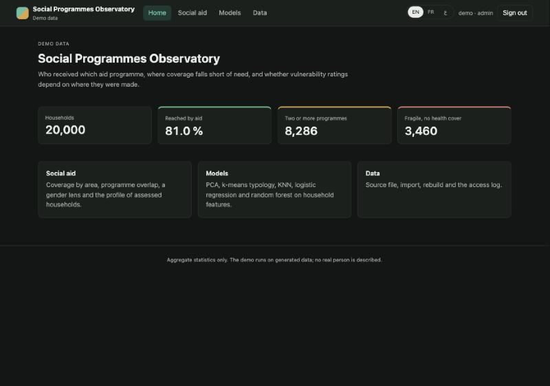
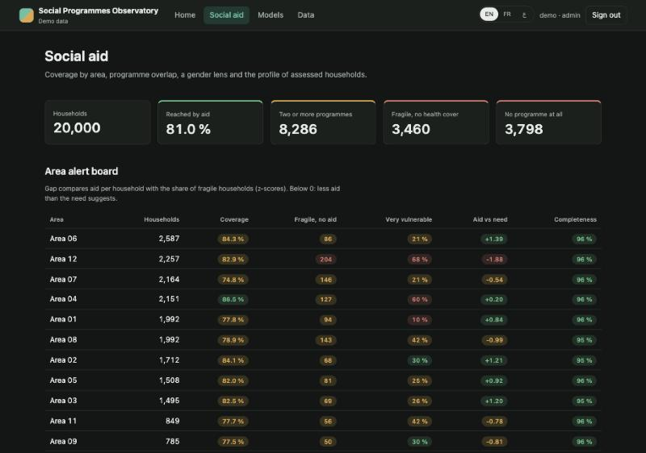
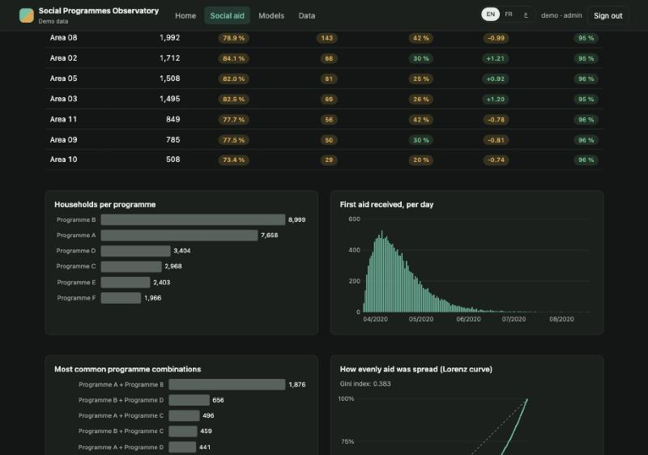
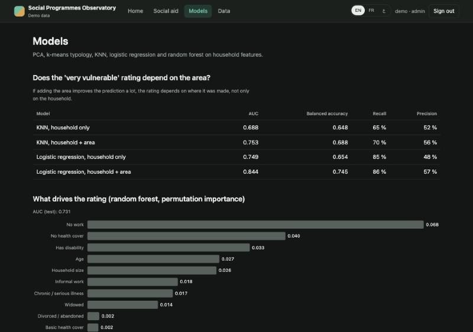
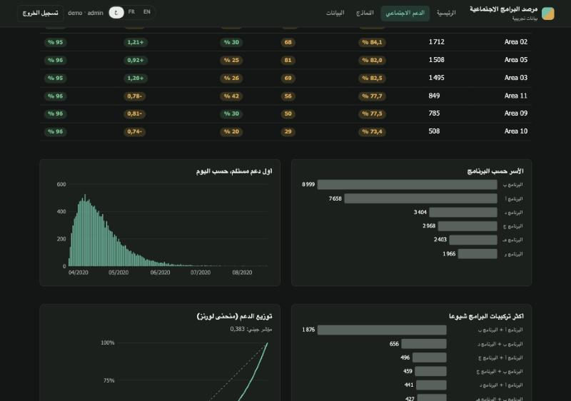
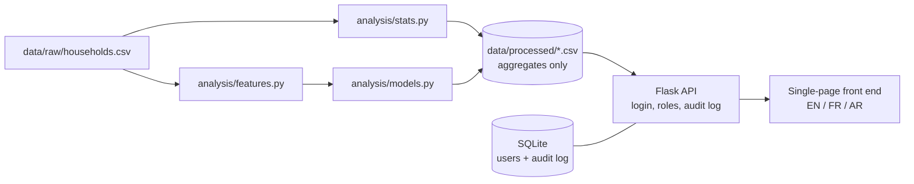

# Social programmes observatory

A small local web app for analysing a social-aid register: who received which programme, where coverage
falls short of need, and whether "vulnerable" ratings depend on the household or on where the rating
was made. It is a Flask + SQLite app with a plain-JavaScript front end in English, French and Arabic
(with right-to-left layout), plus a set of pandas / scikit-learn scripts that do the analysis.

I first built this for a real register that I can't share. This public version keeps the method and the
app, leaves out everything that only made sense with personal data, and comes with a generator of fake
households so anyone can run it. **Every number in this README and in the screenshots comes from that
generated data.**



## What it does

- **Area alert board**: coverage, fragile households with no aid, share rated "very vulnerable", and an
  *aid vs need* score per area (aid per household minus need, both as z-scores), plus how complete the records are.
- **Programmes**: households per programme, the most common combinations, first aid received per day,
  and a Lorenz curve with the Gini index of how evenly aid was spread.
- **Gender lens and profile**: aid and vulnerability for women heads of household, widows, single parents,
  and the profile of assessed households by status, health, cover, work, age and household size.
- **Models**:
  - PCA and a k-means typology of households (k picked by silhouette score);
  - PCA + k-means at area level;
  - KNN and logistic regression predicting "very vulnerable", **with and without the area**. If adding the area
    improves the prediction a lot, the rating depends on who did it, not only on the household. That was the
    question I most wanted to answer;
  - random-forest permutation importance.
- **Data page** (admins): replace the input CSV from the browser (columns are checked, the old file is
  archived), rebuild everything in the background with a live log, and read the access log.

| Area alert board | Charts |
|---|---|
|  |  |

| Models | Arabic (RTL) |
|---|---|
|  |  |

## How it is built



- `observatory/pipeline.py` runs each analysis script in its own Python process (`python -I`) and writes
  aggregate CSV files. The household-level feature table is deleted as soon as the models have run.
- The API only serves those aggregate files. **No household row ever reaches the browser or the database.**
  SQLite holds users (hashed passwords, `admin` or `analyst` role) and the audit log.
- Sessions are HTTP-only, `SameSite=Strict` cookies with an 8-hour lifetime. Failed logins are slowed down
  and logged. The server binds to `127.0.0.1` by default and sends `nosniff`, `DENY` framing and `no-store` headers.
- The front end is one `app.js` with no build step. Each page is a function that builds DOM nodes, and
  charts are hand-written SVG (`charts.js`).

Stack: Python 3, Flask, pandas, NumPy, scikit-learn, SQLite, vanilla JavaScript and SVG, pytest.

## Run it

You need Python 3 with pip (I developed it on Python 3.14).

```bash
./run.sh
```

The first run creates a virtual environment, generates 20,000 fake households if `data/raw/households.csv`
does not exist, builds the statistics (about a minute) and asks you to create an admin account.
Then open http://127.0.0.1:8050.

Step by step instead:

```bash
python3 -m venv .venv && .venv/bin/pip install -r requirements.txt
.venv/bin/python scripts/make_demo_data.py --rows 20000
.venv/bin/python manage.py import
.venv/bin/python manage.py add-user alice --role admin
.venv/bin/python manage.py serve
```

Settings are environment variables (see `.env.example`). To use your own data, follow
[docs/data-format.md](docs/data-format.md).

Tests (they generate their own small dataset, run the pipeline and call the API with both roles):

```bash
.venv/bin/pip install pytest && .venv/bin/python -m pytest -q
```

## About the demo data

`scripts/make_demo_data.py` draws random households across twelve areas named "Area 01" to "Area 12".
It has two effects built in on purpose, so the analyses have something to find:

- vulnerability depends on household traits such as disability, no work, no health cover and widowhood;
- each area rates households a little more or less severely than the others.

So the "with area" models do better here because the generator was written that way. With real data,
that comparison is the interesting part.

## What I learned

- The most useful output was not a chart but a check on the process. Comparing models with and without the
  area is a simple way to see whether a rating depends on who did it.
- Keeping personal data out by design is easier than protecting it afterwards. The pipeline writes aggregates,
  the API serves only aggregates, and the database never sees a household.
- Small tools for non-developers need boring features: a one-command start, column checks on upload,
  a rebuild button with a visible log, and an audit trail.
- Writing the front end without a framework kept it fast to change, but RTL support touches every layout
  rule, so I had to plan for it from the start.

## License

MIT, see [LICENSE](LICENSE).
